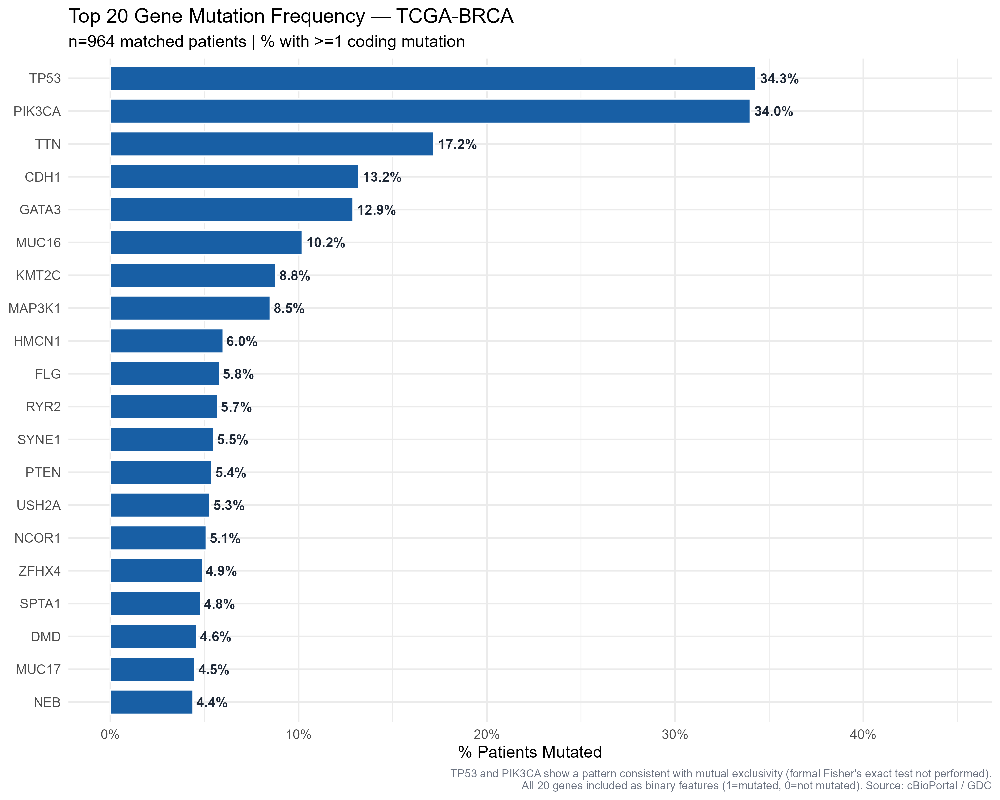
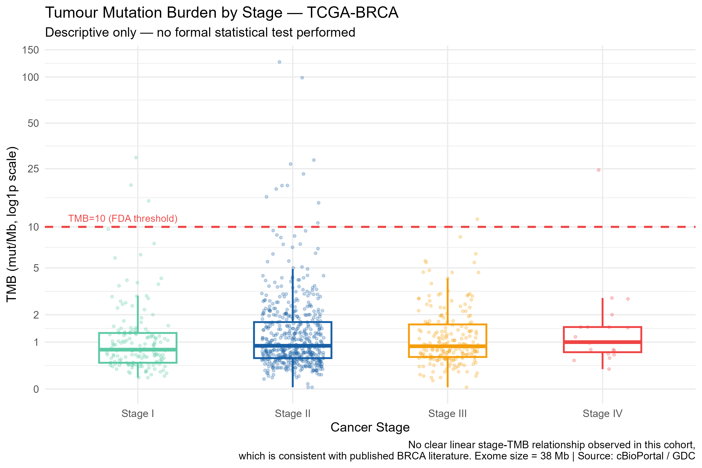
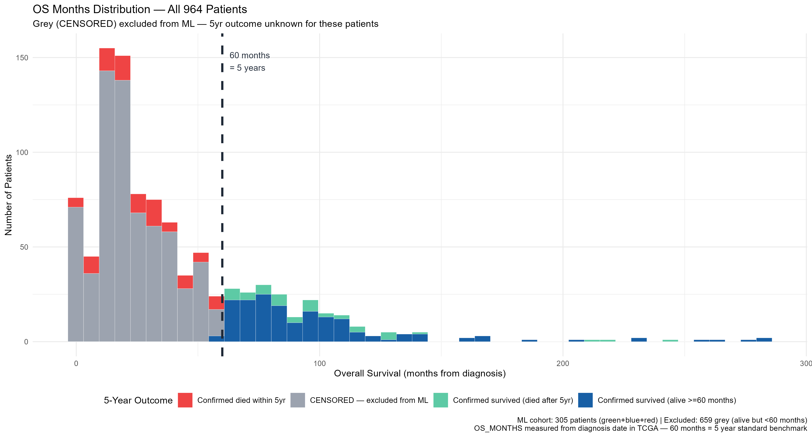
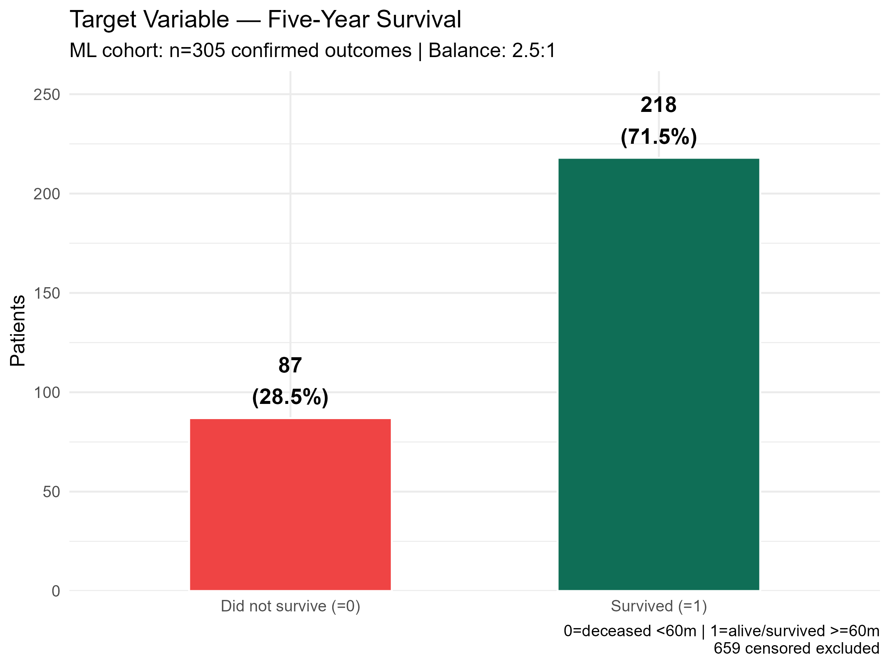
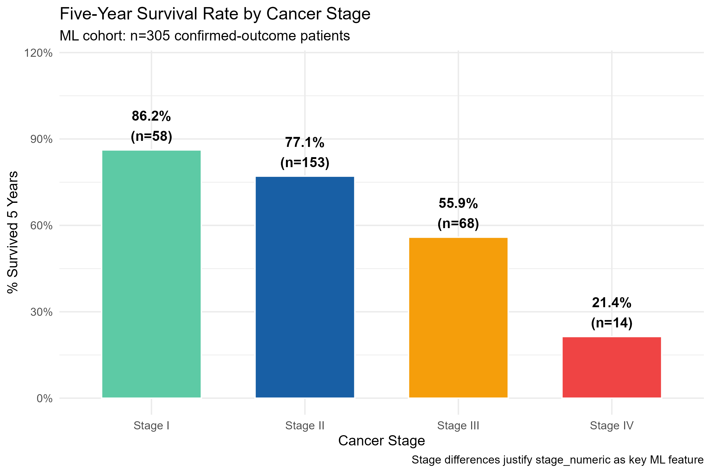
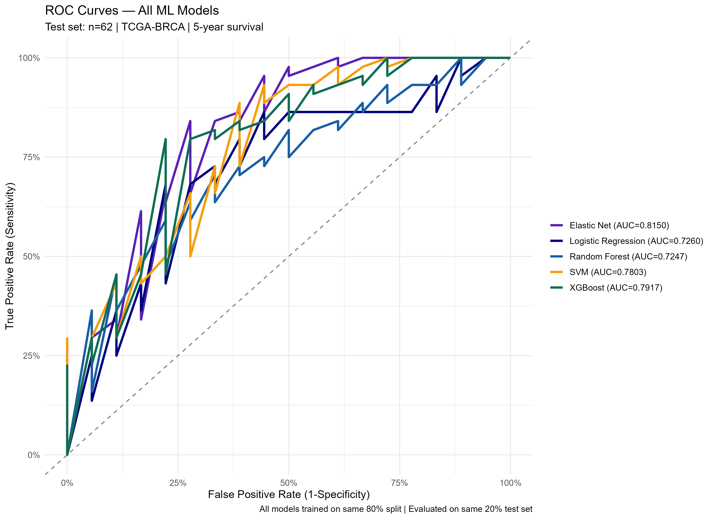
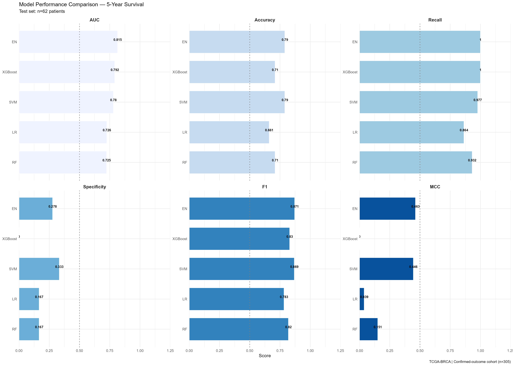
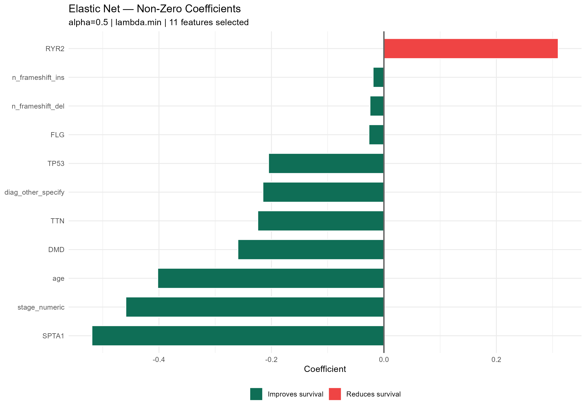
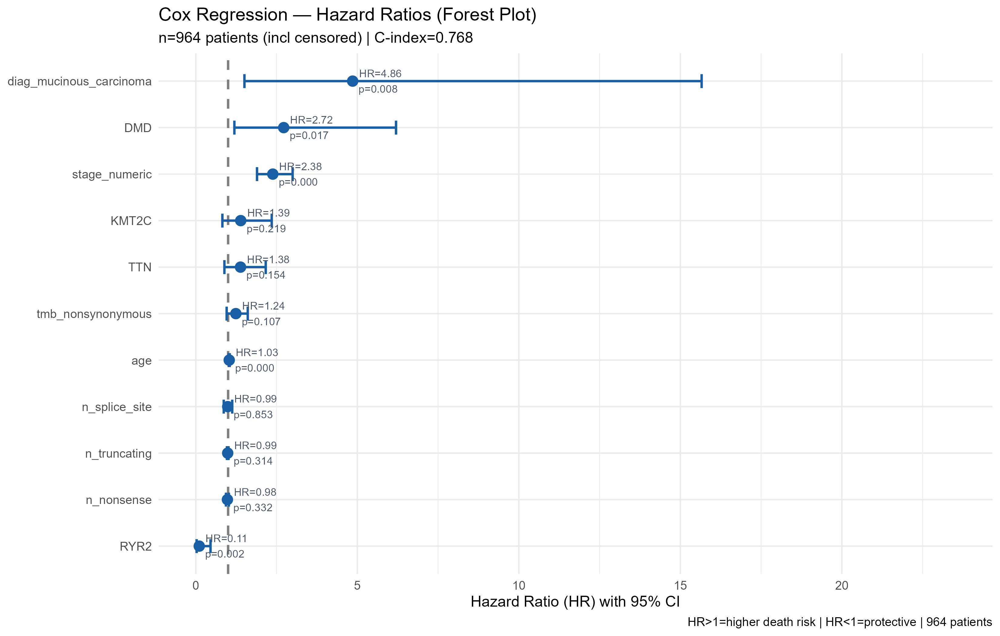
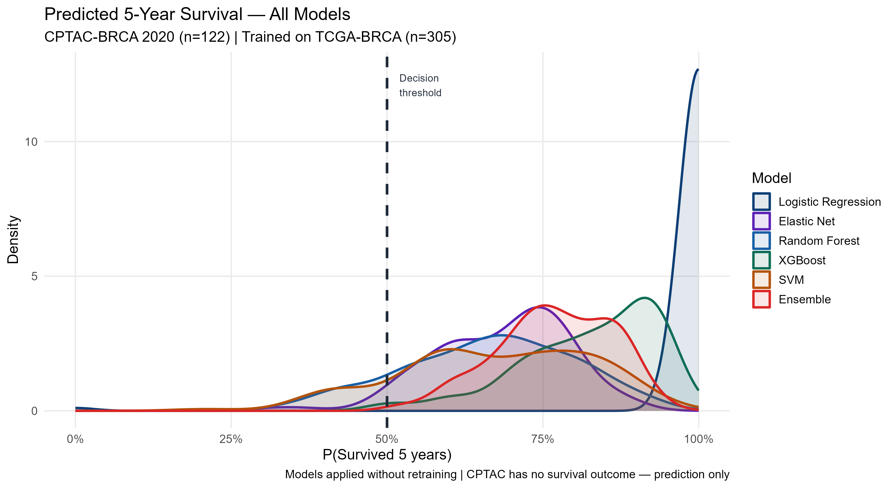

# Clinical–Genomics Harmonisation and AI Baseline Module

> A reproducible R pipeline that harmonises clinical metadata with somatic mutation calls from TCGA-BRCA,
> characterises the resulting mutation landscape, builds a machine-learning-ready feature table with a
> confirmed five-year survival outcome, and benchmarks five baseline classifiers alongside a Cox
> proportional-hazards model.


---

## 1. Overview

Clinical annotation and somatic mutation data describe the same patients at different resolutions: one row per
patient for clinical variables, one row per variant for mutations. Before any model can be trained the two have
to be reconciled into a single patient-level table where every row is one person and every column means the same
thing for everybody.

This module performs that harmonisation for TCGA-BRCA and uses it to answer a concrete question:

> **How well do clinical variables and somatic mutation features predict five-year survival, and which model
> family copes with the class imbalance that this outcome produces?**

The pipeline runs end to end in R — from raw cBioPortal files to cleaned tables, mutation-landscape figures, a
feature table, trained models and an external-cohort test — in nine numbered scripts.

**Headline results**

| | |
|---|---|
| Matched clinical + genomic cohort | **964 patients** (87.8% of 1,098 clinical records) |
| Coding mutations retained | **66,687** of 89,012 (74.9%) across 15,344 genes |
| Patients with a confirmed five-year outcome | **305** — 218 survived (71.5%), 87 did not (28.5%) |
| Best classifier (held-out test, n = 62) | **Elastic Net, AUC 0.815**, MCC 0.463 |
| Strongest predictors | Stage (Cox HR 2.38) and age (HR 1.03), consistent across all models |
| External cohort | CPTAC-BRCA 2020 — prediction only; no outcome data available for scoring |

---

## 2. Scientific motivation

Outcome in breast cancer is shaped by variables recorded in different ways. Stage and age are patient-level
facts; mutations must first be aggregated into patient-level quantities such as tumour mutation burden, counts
by variant class, or per-gene flags. How that aggregation is performed, which patients survive the join, and how
the outcome is defined all determine whether downstream model performance reflects biology or bookkeeping.

This module therefore treats harmonisation and outcome definition as analytical steps in their own right —
documented, validated and reported — rather than as preparation to be passed over quickly.

---

## 3. Datasets and sources

Three TCGA cohorts were reviewed (script 01) before one was selected.

| Metric | **TCGA-BRCA** | TCGA-LUAD | TCGA-LAML |
|---|---|---|---|
| Role | **Primary dataset** | Reviewed, set aside | Reviewed, set aside |
| Clinical patients × columns | 1,098 × 31 | 585 × 33 | 200 × 37 |
| Patients with mutation calls | 964 usable (965 in MAF) | 557 | 199 |
| Total mutations (MAF) | 89,012 | 190,868 | 10,841 |
| Age available | Yes (16 missing) | Yes (94 missing) | **No — entirely missing** |
| AJCC stage available | Yes (12 missing) | Yes (71 missing) | **Not applicable** |
| Overall survival | 945 alive / 152 deceased | 334 alive / 188 deceased / 63 NA | 67 alive / 133 deceased |
| Disease-free survival | Yes | Partial | No |
| Top gene by raw count | PIK3CA (367 mutations) | TTN (known passenger) | DNMT3A (77 mutations) |

**TCGA-BRCA was selected** as the largest cohort, with the most complete clinical annotation (age 98.5%, stage
98.9%, overall survival 99.9%, disease-free survival 85.8%) and standard AJCC staging. TCGA-LUAD was set aside
for this task: it is smaller, 10.8% of patients lack `OS_STATUS`, and its top raw-count gene is a passenger.
TCGA-LAML remains a candidate for cross-cancer testing but has no age or staging data at all.

An independent cohort, **CPTAC-BRCA 2020** (122 patients), was evaluated as an external test — see Section 8.

```
TCGA-BRCA  : https://www.cbioportal.org/study/summary?id=brca_tcga_gdc
TCGA-LUAD  : https://www.cbioportal.org/study/summary?id=luad_tcga_gdc
TCGA-LAML  : https://www.cbioportal.org/study/summary?id=laml_tcga_pan_can_atlas_2018
CPTAC-BRCA : https://www.cbioportal.org/study/summary?id=brca_cptac_2020
```

Each study provides `data_clinical_patient.txt`, `data_clinical_sample.txt` and `data_mutations.txt`. All are
open-access, de-identified public releases; no restricted or patient-identifiable data is used anywhere in this
pipeline.

---

## 4. Harmonisation workflow

### 4.1 Clinical cleaning (script 02)

The clinical patient file (1,098 × 31) and sample file (1,102 × 10) were standardised into **21 analysis-ready
columns**: `patient_id`, `age`, `os_event`, `os_months`, `vital_status_clean`, `survival_days`, `dfs_event`,
`dfs_months`, `path_stage_raw`, `stage_clean`, `stage_numeric`, pathological T/N/M stage, `year_diagnosis`,
`primary_diagnosis` and sample-level fields.

- `os_event` is 0 = alive, 1 = deceased, derived from `OS_STATUS`; `survival_days` takes `DAYS_TO_DEATH` for
  deceased patients and `DAYS_LAST_FOLLOWUP` otherwise.
- **Stage parsing order matters.** Stage strings are matched IV → III → II → I, most specific prefix first.
  Checking `"Stage II"` before `"Stage III"` silently misclassifies Stage III patients, because `"Stage IIIA"`
  contains the substring `"Stage II"` — a well-known TCGA cleaning pitfall.
- Files are read with `read_tsv(comment = "#")` and an explicit missing-value set (`""`, `NA`, `[Not Available]`,
  `[Not Applicable]`, `[Unknown]`, `[Discrepancy]`), because cBioPortal exports carry metadata header rows and
  several different null encodings.

Stage distribution across all 1,098 clinical patients:

| Stage | Patients | % | Deceased | % deceased | Mean OS (months) |
|---|---|---|---|---|---|
| Stage I | 183 | 16.7% | 16 | 8.7% | 48.8 |
| Stage II | 621 | 56.6% | 66 | 10.6% | 39.5 |
| Stage III | 249 | 22.7% | 44 | 17.7% | 35.3 |
| Stage IV | 20 | 1.8% | 15 | **75.0%** | 34.3 |
| Other / NA | 25 | 2.3% | — | — | — |

Deceased patients show a *higher* mean OS (51.7 months) than patients alive at last contact (38.7 months). This
is right-censoring, not a survival advantage: for living patients `OS_MONTHS` records time to last contact
rather than total lifespan. The same phenomenon is what makes the outcome definition in Section 5 non-trivial.

### 4.2 Mutation processing (script 03)

The raw MAF (89,012 records × 140 columns) was filtered to protein-altering variant classes.

| Category | Variant classes | Decision |
|---|---|---|
| Coding — retained | Missense, Nonsense, Frame_Shift_Del, Frame_Shift_Ins, Splice_Site, In_Frame_Del, In_Frame_Ins, Nonstop, Translation_Start_Site | **Kept** — alter the protein product |
| Non-coding — removed | Silent, RNA, Intron, 3'/5'Flank, 3'/5'UTR, Splice_Region, IGR | Removed — synonymous or outside coding regions |

| Metric | Value |
|---|---|
| Coding mutations retained | **66,687** (74.9%) |
| Non-coding removed | 22,325 (25.1%) |
| Patients with ≥ 1 coding mutation | 964 |
| Coding mutations per patient | median 33, mean 69.2 |
| Tumour mutation burden | median 0.87, mean 1.82 mut/Mb |
| Hypermutated (TMB > 10 mut/Mb) | 17 patients (1.8%) |
| Unique mutated genes | 15,344 — 15 genes in ≥ 5% of patients, 6 in ≥ 10% |

TMB uses coding mutations ÷ 38 Mb, the standard exome capture target size in cancer genomics.

### 4.3 Patient identifier harmonisation (script 04)

Patient identifiers were extracted from the first 12 characters of the MAF tumour-sample barcode
(`TCGA-AN-A046-01A-11D-A12B-09` → `TCGA-AN-A046`) and joined to the cleaned clinical table.

| Category | N | % of clinical | Note |
|---|---|---|---|
| Total clinical patients | 1,098 | 100% | All records with clinical metadata |
| Patients with ≥ 1 coding mutation | 964 | 87.8% | After the coding filter |
| **Matched — in both layers** | **964** | **87.8%** | Enter the merged dataset |
| Clinical only (not sequenced) | 134 | 12.2% | Insufficient tumour material, DNA quality or low cellularity |
| Genomic only (no clinical record) | 0 | 0% | Expected — TCGA requires clinical enrolment |

The merged clinical–genomic dataset holds **964 patients × 34 columns**: clinical derived variables, genomic
counts (`n_total_coding`, `n_missense`, `n_nonsense`, `n_frameshift_del`, `n_frameshift_ins`, `n_splice_site`,
`n_inframe_del`, `n_inframe_ins`, `n_truncating`, `n_unique_genes`, `mutation_burden`) and sample fields
(`tmb_nonsynonymous`, `sample_type`). A match rate of 87.8% is typical for a TCGA cohort; the 134 unmatched
patients remain in the cleaned clinical file and are excluded only from modelling.

---

## 5. Mutation landscape (scripts 05–06)

Descriptive summaries and landscape figures were produced for the 964-patient merged cohort using ggplot2 and
maftools.

| | |
|---|---|
|  |  |
| Top coding-mutated genes, n = 964 | Tumour mutation burden by AJCC stage (log₁₀) |

- **TP53 (34.3%) and PIK3CA (34.0%) are co-dominant**, each mutated in roughly a third of patients, followed by
  TTN (17%), CDH1 (13.2%), GATA3 (12.9%), MUC16 (10%) and KMT2C (8.8%). Many patients carry TP53 or PIK3CA but
  not both. A pattern consistent with these genes marking largely distinct molecular subtypes has been reported
  previously — TP53 alterations more frequent in triple-negative/basal-like tumours, PIK3CA in luminal subtypes —
  though **subtype assignment was not performed in this module**, so that interpretation is cited rather than
  demonstrated here.
- **Variant classes:** missense 55,310 (62.1%) and nonsense 4,886 (5.5%) retained; silent 19,452 (21.9%) and
  other non-coding classes removed.
- **Mutation counts per patient are strongly right-skewed:** most patients carry 10–100 coding mutations, with
  one hypermutated outlier at 4,752 — about 125× the median, which is why the median (33) describes this cohort
  better than the mean (69.2).
- **TMB shows no clear monotonic trend with stage**, consistent with published BRCA literature; the 17 points
  above 10 mut/Mb are the hypermutated patients identified in script 03.
- **Mutational signature:** C>T transitions dominate (40,319 events, versus C>G 16,260 and C>A 12,490) and
  transitions exceed transversions (≈60% vs 40%), the pattern expected from COSMIC signature SBS1 — spontaneous
  deamination of 5-methylcytosine, an age-related process.
- **Variant allele frequency** peaks at 0.15–0.25 (mean 0.248, median 0.220), typical of heterozygous somatic
  mutations in bulk tumour sequencing, with a smaller bump near 0.50 consistent with homozygous events or loss of
  heterozygosity.

Driver-gene frequency by stage (data-driven, no subtype assumption):

| Gene | Stage I | Stage II | Stage III | Stage IV | Role |
|---|---|---|---|---|---|
| TP53 | 36.2% | 43.4% | **44.4%** | 36.8% | Tumour suppressor, DNA-damage checkpoint |
| PIK3CA | **46.9%** | 42.0% | 37.4% | 31.6% | Oncogene, PI3K pathway |
| CDH1 | 9.2% | 16.8% | **20.5%** | 10.5% | E-cadherin, cell adhesion |
| GATA3 | 13.1% | 14.8% | 18.1% | **31.6%** | Transcription factor |
| KMT2C | 9.3% | 8.8% | 7.6% | 10.5% | Chromatin remodelling |
| MAP3K1 | 9.3% | 9.1% | 7.1% | 0% | Stress kinase |

TP53 frequency rises from Stage I to Stage III while PIK3CA declines from Stage I to Stage IV. Stage IV contains
only 20 patients, so the Stage IV column should be read with caution.

---

## 6. Outcome definition and the modelling cohort (script 07)

No survival-status column exists in the raw clinical data, so `five_year_survival` was engineered from
`os_event` and `os_months` (60 months = 5 years).

| Case | Condition | `five_year_survival` | Interpretation |
|---|---|---|---|
| 1 | `os_event == 0` and `os_months ≥ 60` | 1 | Confirmed survivor — alive beyond five years |
| 2 | `os_event == 1` and `os_months ≥ 60` | 1 | Confirmed survivor — died after five years |
| 3 | `os_event == 1` and `os_months < 60` | 0 | Confirmed non-survivor |
| 4 | `os_event == 0` and `os_months < 60` | `NA` | **Censored — excluded from modelling** |

**Why case 4 is excluded.** A patient who is alive after 20 months of follow-up has not been observed to survive
five years. Labelling such patients "survived" would train the model on an assumption rather than an
observation, and would inflate the majority class. Only patients whose five-year status is actually resolved are
labelled.

| Outcome group | Patients | % of 964 | In modelling cohort |
|---|---|---|---|
| Confirmed survived (alive ≥ 60 months) | 173 | 17.9% | Yes — label 1 |
| Confirmed survived (died after 5 years) | 45 | 4.7% | Yes — label 1 |
| Confirmed died within 5 years | 87 | 9.0% | Yes — label 0 |
| Censored, outcome unresolved | **659** | **68.4%** | No |

**Modelling cohort: 305 patients — 218 survived (71.5%), 87 did not (28.5%); class ratio ≈ 2.5 : 1.**

| | |
|---|---|
|  |  |
| Which patients have a resolved five-year outcome | Target distribution, n = 305 |

Within this cohort five-year survival falls steeply with stage: **Stage I 86.2%** (n = 58), Stage II 77.1%
(n = 153), Stage III 55.9% (n = 68), **Stage IV 21.4%** (n = 14) — the steepest gradient in the dataset and the
reason stage dominates every model in Section 7.



### Feature table

| Group | Features | Type | N |
|---|---|---|---|
| Clinical | `age`, `stage_numeric` (I = 1 … IV = 4), `primary_diagnosis` (one-hot) | Continuous / ordinal / binary | ~6 |
| Genomic summary | `tmb_nonsynonymous`, `n_truncating`, `n_nonsense`, `n_frameshift_del`, `n_frameshift_ins`, `n_splice_site` | Continuous | 6 |
| Gene flags | TP53, PIK3CA, TTN, CDH1, GATA3, MUC16, KMT2C, MAP3K1, HMCN1, FLG, RYR2, SYNE1, PTEN, USH2A, NCOR1, ZFHX4, SPTA1, DMD, MUC17, NEB | Binary (1 = mutated) | 20 |
| Target | `five_year_survival` | Binary | 1 |
| Tracking only | `patient_id` — removed before model fitting to prevent leakage | Identifier | 1 |

The 20 gene flags are the most frequently mutated genes in the cohort, included **without** pre-filtering for
driver versus passenger status so that the models themselves weigh their relevance. Large genes such as TTN and
MUC16 are expected to carry passenger mutations.

---

## 7. Modelling and evaluation (script 08)

### 7.1 Design

- **Split before scaling.** The 305-patient cohort is split 80/20, stratified on the outcome, seed 42 — roughly
  244 training and 62 test patients (44 survivors, 18 non-survivors). The scaler (mean and standard deviation) is
  fitted on the training set only and applied to the test set; binary gene flags and one-hot columns are left
  unscaled. Fitting the scaler before the split would let test-set information influence training.
- **Five classifiers:** Logistic Regression (`glm`), Elastic Net (`glmnet`, α = 0.5), Random Forest, XGBoost and a
  radial-kernel SVM (`e1071`). All share the 0.5 decision threshold and seed 42.
- **Cox proportional-hazards model** (`survival`) fitted alongside them, which uses censored follow-up and so
  draws on patients the classifiers cannot use.
- **Metrics:** AUC, accuracy, recall, precision, specificity, F1 and MCC, reported together because accuracy and
  recall alone are uninformative under class imbalance.

### 7.2 Classifier results — held-out test set (n = 62)

| Model | AUC | Accuracy | Recall | Precision | Specificity | F1 | MCC |
|---|---|---|---|---|---|---|---|
| **Elastic Net** | **0.815** | 0.790 | 1.000 | 0.772 | 0.278 | 0.871 | **0.463** |
| XGBoost | 0.792 | 0.710 | 1.000 | 0.710 | 0.000 | 0.830 | 0.000 |
| SVM | 0.780 | 0.790 | 0.977 | 0.782 | **0.333** | 0.869 | 0.446 |
| Logistic Regression | 0.726 | 0.661 | 0.864 | 0.717 | 0.167 | 0.784 | 0.039 |
| Random Forest | 0.725 | 0.710 | 0.932 | 0.732 | 0.167 | 0.820 | 0.151 |

| | |
|---|---|
|  |  |
| ROC curves, all five models | Metrics side by side |

**Interpretation.** Elastic Net gives the best discrimination and retains some ability to identify
non-survivors. XGBoost reaches a comparable AUC (0.792) but at the 0.5 threshold labels every test patient a
survivor, identifying none of the 18 true non-survivors — a class-imbalance failure shared in weaker form by
Logistic Regression and Random Forest. SVM achieves the highest specificity (0.333) while keeping a strong AUC.
Elastic Net's advantage is plausibly its combination of regularisation, which suits a moderate sample size, with
retained class separation. The contrast between XGBoost's AUC and its specificity is the practical lesson:
**AUC measures ranking, not threshold-dependent clinical usability.**

Elastic Net retained **11 non-zero features**. Stage and age are the strongest predictors of reduced five-year
survival; several gene flags (SPTA1, TP53, TTN, DMD) contribute smaller effects.



### 7.3 Cox proportional-hazards model

| Term | Hazard ratio | 95% CI | p |
|---|---|---|---|
| `stage_numeric` | **2.383** | 1.895 – 2.997 | < 0.001 |
| `age` | **1.034** | 1.020 – 1.049 | < 0.001 |
| `diag_mucinous_carcinoma` | 4.855 | 1.505 – 15.659 | 0.008 |
| `DMD` mutated | 2.721 | 1.194 – 6.198 | 0.017 |
| `RYR2` mutated | 0.106 | 0.025 – 0.455 | 0.003 |
| `tmb_nonsynonymous` | 1.239 | 0.955 – 1.608 | 0.107 |
| `KMT2C`, `TTN`, mutation-type counts | 0.978 – 1.390 | CI spans 1 | not significant |



Stage and age dominate here too, agreeing with the classifier importances. The individual gene terms rest on
small patient numbers with wide intervals and are **exploratory signals, not established prognostic effects**.

---

## 8. External cohort test — CPTAC-BRCA 2020 (scripts 09a, 09b)

Script 09a audits whether an independent cohort can support the same analysis before any model is applied to it.

| Check | Result |
|---|---|
| Patients (clinical / with mutations) | 122 / 122 |
| Coding mutations | 19,548 — median TMB 1.78 mut/Mb (vs 0.87 in TCGA-BRCA) |
| Overlap of the 20 training genes | **20 / 20 present** |
| `AGE` | Available, 86.1% complete (105/122) |
| `OS_STATUS`, `OS_MONTHS`, AJCC stage, primary diagnosis | **Not present in this release** |

Because the outcome columns are absent, the five-year outcome cannot be computed in CPTAC and **no AUC,
sensitivity or specificity can be calculated there**. Script 09b therefore runs in prediction-only mode: the five
trained models plus an unweighted ensemble generate predicted survival probabilities, with missing stage imputed
as Stage II (the training-set median) and missing diagnosis one-hot columns set to 0.

- 72 of 122 patients (59.0%) fall in the "high survival predicted" band (ensemble probability ≥ 0.75); the
  remaining 50 (41.0%) fall between 0.50 and 0.75. No patient is predicted below the 0.5 threshold.
- Agreement is high: all five models agree on the predicted class for 96 of 122 patients (78.7%); four of five
  agree for 19 patients, three of five for 6, and two of five for 1.
- Predicted probability declines gradually with age, consistent with the age effect learned on TCGA-BRCA.



> **This is a transferability check, not external validation.** Without ground-truth outcomes the results
> describe predicted risk distributions only, and imputing a single stage for every patient flattens real
> heterogeneity in that cohort. Formal validation requires a cohort with complete survival annotation.

---

## 9. Technologies and tools

| Layer | Tools |
|---|---|
| Language | R |
| Data handling | tidyverse (dplyr, tidyr, readr, stringr, ggplot2), scales |
| Genomics | maftools (MAF summary, oncoplot, Ti/Tv), cBioPortal flat files |
| Survival analysis | survival, survminer |
| Machine learning | glmnet (Elastic Net), randomForest, xgboost, e1071 (SVM), pROC |
| Visualisation | ggplot2, pheatmap, maftools built-in plots |

Reproducibility: the random seed is fixed at 42 wherever sampling occurs, and the train/test assignment is
written to `outputs/TCGA-BRCA/models/train_test_split_ids.csv` so the split can be reconstructed exactly.

---

## 10. Repository structure

```
01R_clinical_genomics/
├── scripts/
│   ├── 01_data_overview.R              review three TCGA cohorts, select the primary dataset
│   ├── 02_clean_clinical_data.R        31 → 21 standardised clinical columns, stage parsing
│   ├── 03_mutation_processing.R        coding-variant filter, TMB, per-patient mutation counts
│   ├── 04_match_patient_ids.R          barcode harmonisation, clinical ∩ genomic merge
│   ├── 05_generate_summary_tables.R    cohort summaries, gene frequency by stage, TMB tables
│   ├── 06_generate_figures.R           mutation-landscape figures (ggplot2 + maftools)
│   ├── 07_build_ml_feature_table.R     outcome construction, gene flags, one-hot diagnosis
│   ├── 08_train_ml_models.R            five classifiers + Cox model, leakage-safe scaling
│   ├── 09a_eda_cptac_brca.R            CPTAC variable-availability and gene-overlap audit
│   └── 09b_test_model_on_cptac.R       apply trained models to CPTAC (prediction only)
│
├── data/
│   ├── raw/                            cBioPortal study files — see Section 3
│   └── processed/TCGA-BRCA/            clinical_cleaned · sample_cleaned · genomics_cleaned ·
│                                       clinical_genomics_merged · feature_table_ml · feature_table_cox
│
└── outputs/TCGA-BRCA/
    ├── figures/                        dataset review · mutation landscape · outcome definition ·
    │                                   per-model ROC, confusion and importance · Cox forest · CPTAC
    ├── tables/                         numbered result tables, 01_* … 09b_*
    └── models/                         ml1_logistic_regression · ml2_elastic_net · ml3_random_forest ·
                                        ml4_xgboost · ml5_svm · cox_model · feature_scaler · split IDs
```

Key result files: `tables/08_model_performance_all.csv` (Section 7.2), `tables/08_cox_hazard_ratios.csv`
(Section 7.3), `tables/07_five_year_outcome_summary.csv` (the modelling cohort) and
`tables/09a_cptac_outcome_feasibility.csv` (why CPTAC cannot be scored).

---

## 11. Reproducing the pipeline

```r
install.packages(c("tidyverse", "maftools", "survival", "survminer", "scales",
                   "glmnet", "randomForest", "xgboost", "e1071", "pROC", "pheatmap"))

# 1. Download the study folders from the cBioPortal links in Section 3 into
#    data/raw/TCGA-BRCA, data/raw/TCGA-LAML, data/raw/TCGA-LUAD, data/raw/TEST_brca_cptac_2020
# 2. Set the working directory to this folder, then run in order:

source("scripts/01_data_overview.R")
source("scripts/02_clean_clinical_data.R")
source("scripts/03_mutation_processing.R")
source("scripts/04_match_patient_ids.R")
source("scripts/05_generate_summary_tables.R")
source("scripts/06_generate_figures.R")
source("scripts/07_build_ml_feature_table.R")
source("scripts/08_train_ml_models.R")
source("scripts/09a_eda_cptac_brca.R")
source("scripts/09b_test_model_on_cptac.R")
```

Scripts are sequential and self-contained; each prints its progress and writes tables and figures to
`outputs/TCGA-BRCA/`. Each script sets an absolute working directory in its header — adjust that line to your
own path before running.

---

## 12. Limitations

- **Cohort size relative to feature count.** 305 confirmed outcomes support 32 features, 20 of them gene flags.
  Individual gene coefficients (SPTA1, DMD, TTN, RYR2) are exploratory and should not be read as validated
  prognostic markers.
- **659 censored patients are unavailable** to the classification task; their five-year status is genuinely
  unresolved. The Cox model is the part of this pipeline that can use their follow-up time.
- **Class imbalance persists** at 71.5% / 28.5%. At the default threshold XGBoost identifies no non-survivors,
  and Logistic Regression and Random Forest identify few.
- **CPTAC cannot validate the model** — it lacks survival, staging and diagnosis data, and stage was imputed as
  Stage II for every patient there.
- **Molecular subtypes were not assigned**, so statements about TP53 and PIK3CA marking distinct subtypes are
  reported as consistency with published work, not as findings of this analysis.
- **Mutation calls are taken as provided** in the cBioPortal GDC-harmonised release: no re-calling, VAF
  thresholding or tumour-purity adjustment was performed.
- **Stage IV is small** (20 patients overall, 14 with confirmed outcomes), so stage-stratified statistics for that
  group carry wide uncertainty.

---

## 13. Future directions

1. **Address class imbalance directly** — class weighting, threshold tuning on training data, or resampling
   (SMOTE) — and report specificity-oriented metrics rather than accuracy.
2. **Obtain a cohort with complete survival annotation** for a formal, AUC-based external validation.
3. **Extend to a second cancer type** (TCGA-LUAD, or TCGA-LAML with its missing age and stage acknowledged) to
   test cross-cancer generalisability.
4. **Lean more on time-to-event modelling**, so that censored patients contribute to the primary analysis rather
   than only to a secondary model.
5. **Add further omics layers** — this clinical–genomic foundation is the base on which the DNA methylation
   module builds.

---

## 14. Contribution

Pipeline design, implementation, analysis and documentation by **Muteeba Azhar**, as the Month 1 deliverable of
the Bioinformatics and AI-Ready Multi-Omics Internship at MultiOmics Intelligence: cohort review and dataset
selection, clinical and mutation data cleaning, identifier harmonisation, outcome engineering, feature-table
construction, model training and evaluation, the CPTAC feasibility audit and prediction run, and all figures,
tables and written documentation in this repository.

---

## 15. Acknowledgements and data attribution

- Data generated by **The Cancer Genome Atlas (TCGA) Research Network** (https://www.cancer.gov/tcga), accessed
  through **cBioPortal for Cancer Genomics**. External test data from the **Clinical Proteomic Tumor Analysis
  Consortium (CPTAC)** BRCA 2020 release, also via cBioPortal.
- Analysis carried out during the Bioinformatics and AI-Ready Multi-Omics Internship at **MultiOmics
  Intelligence**.
- Software: the R Core Team and the authors of tidyverse, maftools, survival, survminer, glmnet, randomForest,
  xgboost, e1071 and pROC.

This repository contains analysis code and derived results from open-access, de-identified public datasets. No
restricted or patient-identifiable data is included.

### References

- Cerami E *et al.* *The cBio Cancer Genomics Portal: an open platform for exploring multidimensional cancer
  genomics data.* Cancer Discovery, 2012.
- Mayakonda A *et al.* *Maftools: efficient and comprehensive analysis of somatic variants in cancer.* Genome
  Research, 2018.
- The Cancer Genome Atlas Network. *Comprehensive molecular portraits of human breast tumours.* Nature, 2012.
- Friedman J, Hastie T, Tibshirani R. *Regularization paths for generalized linear models via coordinate
  descent.* Journal of Statistical Software, 2010.
- Alexandrov LB *et al.* *Signatures of mutational processes in human cancer.* Nature, 2013. (COSMIC SBS1)

---

*R · TCGA-BRCA · cBioPortal · scripts 01–09b · five classifiers + Cox model · leakage-safe preprocessing*
