# Epigenomics Integration and AI-Ready Multi-Omics Pipeline

> A reproducible R pipeline that adds DNA methylation (Illumina HumanMethylation450) as a second omics layer to
> the TCGA-BRCA clinical–genomic cohort: raw GDC files are downloaded and assembled, quality-controlled, reduced
> to interpretable per-patient features, integrated with clinical and mutation data, and tested in five baseline
> classifiers across three feature sets.


---

## 1. Overview

DNA methylation is a chemical mark on cytosines at CpG sites. When a gene's promoter is methylated the gene is
usually switched off, and tumours exploit this: they hypermethylate the promoters of protective genes while
losing methylation across the rest of the genome. Methylation therefore records tumour biology that mutation
calls cannot, which makes it a natural second omics layer — and a realistic test of the question every
multi-omics project eventually faces:

> **Does adding an epigenomic layer improve five-year survival prediction, and can a cohort of this size prove
> it?**

**Headline results**

| | |
|---|---|
| Methylation files downloaded and md5-verified | **680 / 680** (8.27 GiB) for 672 patients |
| Assembled matrix | 486,427 probes × 680 samples, numerically identical to `TCGAbiolinks::GDCprepare()` |
| After quality control | **380,811 CpGs × 679 samples** (78.3% of probes retained) |
| Integrated dataset | **671 patients × 103 columns** (clinical + genomic + 36 methylation features) |
| Modelling cohort | **211 patients** with a confirmed five-year outcome — 147 training / 64 test |
| Best model | **Elastic Net, combined feature set — test AUC 0.792 (95% CI 0.68–0.91)** |
| Effect of adding methylation | +0.050 AUC for the best model, consistent in cross-validation, not statistically significant with 18 test deaths |
| Where the models look | Methylation components supply **52.4%** of XGBoost's and **33.9%** of Random Forest's feature importance |

---

## 2. Relationship to the clinical–genomics module

This module extends the clinical–genomics pipeline rather than replacing it.

| Inherited unchanged | Added here |
|---|---|
| The TCGA-BRCA cohort and its clinical variables | 450K methylation profiles for 671 of those patients |
| The `five_year_survival` outcome (confirmed outcomes only) | 36 methylation features per patient, reduced to 29 model features |
| Feature block A — age, stage, mutation burden and counts, 20 gene flags, histology | Feature blocks B (methylation summary) and C (methylation components) |
| The five model families and their hyperparameters | Three feature sets per model, DeLong tests, repeated cross-validation |

Because the target and the clinical–genomic features are identical, comparing "clinical + genomic" with
"clinical + genomic + methylation" is a clean test of what the new layer contributes.

---

## 3. Datasets and sources

| Item | Detail |
|---|---|
| Assay | Illumina HumanMethylation450, level-3 β values from the GDC SeSAMe pipeline |
| Source | NCI Genomic Data Commons, project TCGA-BRCA |
| Files used | 680 primary-tumour files (8.27 GiB) for 672 patients, matched to the clinical–genomic cohort of 964 |
| Probe annotation | Zhou lab InfiniumAnnotation, HM450 hg38 (gencode v36, design manifest, general quality mask) |
| Clinical and genomic layer | Merged clinical–genomic dataset, 964 patients |
| Reference genome | hg38 |

```
GDC portal : https://portal.gdc.cancer.gov/projects/TCGA-BRCA
Annotation : https://zwdzwd.github.io/InfiniumAnnotation
```

Only primary-tumour samples were used, because the mutation calls also come from primary tumours; mixing in
adjacent-normal tissue or metastases would compare unlike material. All data are open-access and de-identified.

**Not stored here:** the 8.27 GiB of downloaded files and the β-value matrices (2.0–2.6 GB each). Script 02
re-downloads the raw files from the GDC and scripts 02b–07 regenerate every processed object.

---

## 4. Data acquisition and assembly (scripts 01, 02, 02b)

### 4.1 Selecting the files

The GDC holds 895 450K files for TCGA-BRCA. Keeping primary tumours leaves 793; matching those to the cohort by
the 12-character patient barcode leaves **680 files for 672 patients** — six patients contributed two or three
replicate samples, resolved in Section 7.

### 4.2 Downloading reliably

`TCGAbiolinks::GDCdownload()` failed repeatedly: its default method retrieves many files as a single compressed
stream, so one network interruption corrupts the whole chunk and a retry restarts from zero. The download was
rewritten to fetch each file separately from the GDC API with `curl`.

- Four parallel connections — more connections measured *slower* on this route, not faster.
- A file counts as complete only when its size **and** md5 checksum match the GDC manifest.
- Completed files are re-verified before each pass, which makes the job fully resumable after an interruption.
- A lock file prevents a second copy of the script writing into the same folder.

**Result: 680 of 680 files verified.** Pass 1 verified 669; pass 2 retried the remaining 11. No file failed.

### 4.3 Assembling one annotated matrix

`GDCprepare()` could not be used: it requires the sesameData package chain, and its memory use measured 725 MB
for 10 files and 1,259 MB for 40 — roughly 12.6 GB for 680 files, against 7.7 GB available. A lean assembler
was written instead, allocating the output matrix once and filling it one file at a time, reading each file
exactly as `GDCprepare()` does.

**Verification.** On the same 52 files both methods returned the same probes, the same samples, the same
missing-value pattern and a **maximum difference of 0**. The assembled object holds 486,427 probes × 680 samples
with β values from 0.0027 to 0.9965; no file required probe re-alignment, a spot check of five random files
matched exactly, and reloading the saved object reproduced the pre-save values.

Probe annotation (chromosome, position, gene, distance to transcription start site, CpG-island context, genomic
region, quality mask) is attached before the matrix is built, which keeps peak memory low. Sample annotation
(patient, vial, processing plate, PAM50 subtype, published TCGA methylation cluster) comes from the subtype
table shipped with TCGAbiolinks.

---

## 5. Quality control and probe filtering (script 03)

### 5.1 Sample quality control

Each tumour is scored on missing values, mean methylation, the balance of unmethylated and methylated CpGs, and
its correlation with a typical sample. A sample fails above 10% missing values.

**How missingness is measured matters.** 33,403 probes are masked by the GDC pipeline in almost every sample.
Counting them makes every sample look roughly 7.5% missing before any real failure, and in testing that rule
rejected about 25% of otherwise sound samples. Missingness is therefore measured only over probes usable across
the cohort; the systematically masked probes are removed by the probe filter in any case.

| Outcome | Samples | Meaning |
|---|---|---|
| Pass | 618 | Normal on every measure |
| Flagged, kept | 61 | Unusual on at least one measure — often low tumour purity rather than a failed assay |
| Fail, removed | 1 | TCGA-OL-A66K, 11.0% missing values |

Sample-specific missingness: median 1.81% (range 0.16–11.01%). Median correlation to the median sample: 0.954.

### 5.2 Probe filtering

| Step | Probes remaining | Removed | % of array |
|---|---|---|---|
| All probes on the array | 486,427 | — | 100.0 |
| CpG probes only (drop ch, rs, control) | 482,421 | 4,006 | 99.2 |
| Mapped to hg38 | 482,391 | 30 | 99.2 |
| Autosomes only (drop chrX, chrY, chrM) | 470,827 | 11,564 | 96.8 |
| Not quality-masked (SNP-affected or cross-reactive) | 442,224 | 28,603 | 90.9 |
| Missing in ≤ 10% of QC-passed samples | **380,811** | 61,413 | **78.3** |

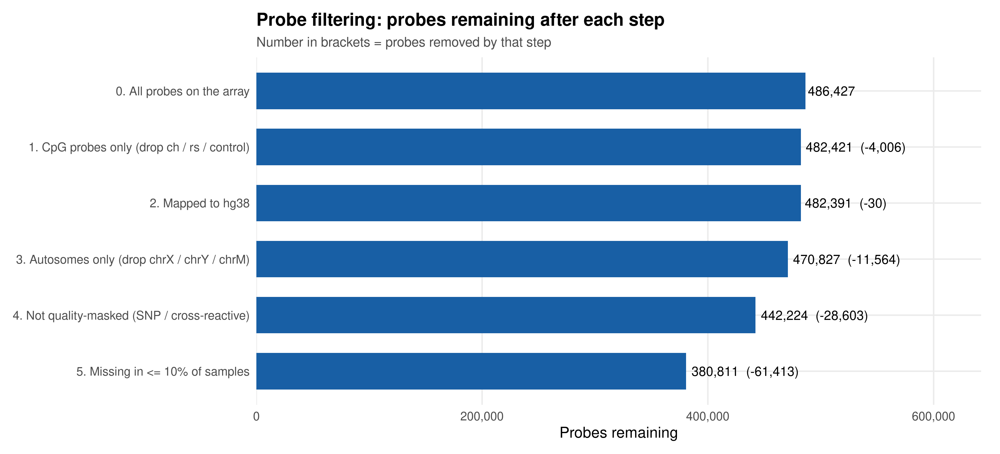

Sex-chromosome methylation reflects sex and X-inactivation rather than tumour biology. Masked probes overlap
common variants or bind more than one genomic location (Zhou et al. 2017), so their values are unreliable.

### 5.3 Does the cleaned data behave as expected?

**Biologically**, the retained probes reproduce the textbook pattern: CpG islands are largely unmethylated
(median β 0.07) while shelves and open-sea regions are methylated (0.83 and 0.78); promoters are low (0.18)
against gene bodies (0.82). **Technically**, ten replicate pairs from six patients agree closely (median
r = 0.990, range 0.977–0.996), clearly better than 300 randomly chosen unrelated pairs (median r = 0.908). The
measurements are reproducible and the expected biology is present.

---

## 6. Methylation structure and batch assessment (script 03)

Principal component analysis on the 5,000 most variable probes asks what separates these tumours — biology or
laboratory processing.

| | |
|---|---|
| 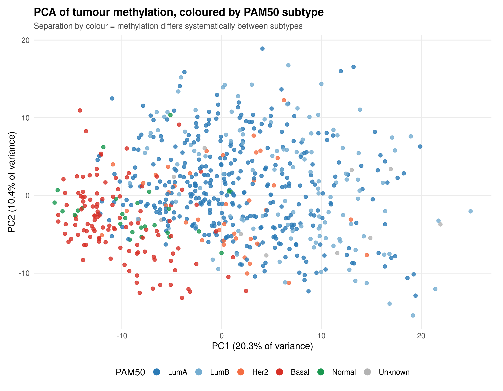 | 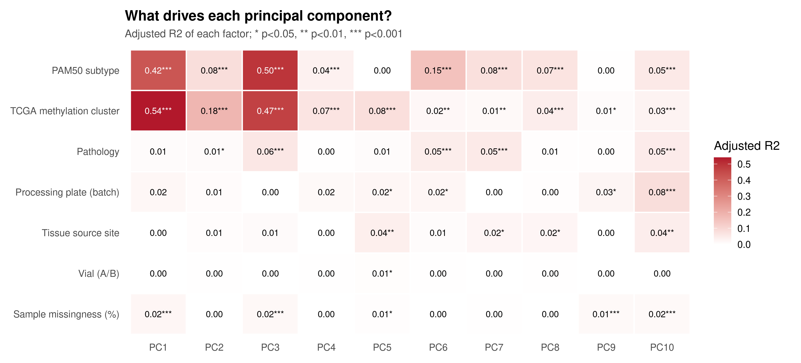 |
| PC1 (20.3% of variance) separates basal-like from luminal tumours | Adjusted R² of each factor against each component |

| Factor | PC1 | PC2 | PC3 | PC4 | PC5 |
|---|---|---|---|---|---|
| TCGA methylation cluster (published) | **0.54** | 0.18 | 0.47 | 0.07 | 0.08 |
| PAM50 subtype | **0.42** | 0.08 | **0.50** | 0.04 | 0.00 |
| Pathology | 0.01 | 0.01 | 0.06 | 0.00 | 0.01 |
| Processing plate (batch) | 0.02 | 0.01 | 0.00 | 0.02 | 0.02 |
| Tissue source site | 0.00 | 0.01 | 0.01 | 0.00 | 0.04 |
| Sample missingness | 0.02 | 0.00 | 0.02 | 0.00 | 0.01 |

**Biological factors dominate the main components; technical factors never exceed 0.08.** There is no meaningful
batch effect, so no batch correction was applied.

Unsupervised clustering (Ward linkage on 1 − correlation, cut into five groups to match the number of published
TCGA methylation clusters) recovers the same structure: cluster **MC1 contains 102 of 107 basal-like tumours**
and 82 of the 95 tumours in published cluster C4, while MC4 gathers 27 of 40 HER2-enriched tumours. Agreement
with PAM50 (adjusted Rand index 0.28) and with the published clusters (0.27) is partial, as expected when
comparing labels derived from gene expression with groups derived from methylation.

---

## 7. Identifier harmonisation and cohort representativeness (script 04)

Seven checks ran before any merge — barcode format, patient and sample identifier derivation, primary-tumour
sample code, duplicate barcodes, uniqueness of cohort identifiers, cohort membership — and **all seven passed
for all 679 samples**.

Where a patient had more than one sample, one was kept by this order of rules: (1) the same tumour vial used for
the mutation data, (2) QC status Pass, (3) vial A, (4) fewer missing values, (5) alphabetical barcode as a fixed
tie-break. All six replicate patients resolved on rule 1 or rule 4, and dropped samples correlated
r = 0.977–0.996 with those kept, so the choice barely affects any result. **679 samples → 671 patients.**

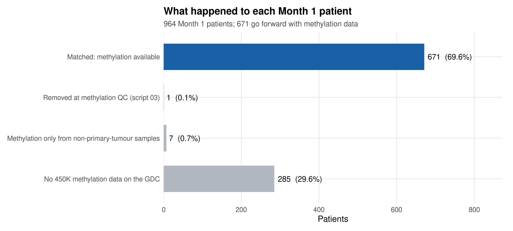

| Cohort patients by methylation status | Patients | % of 964 |
|---|---|---|
| Matched — methylation available | **671** | 69.6% |
| No 450K file on the GDC | 285 | 29.6% |
| Methylation only from non-primary-tumour samples | 7 | 0.7% |
| Removed at methylation quality control | 1 | 0.1% |

**Are these 671 patients representative?** Compared with the 293 cohort patients without methylation:

| Variable | With methylation | Without | p | Verdict |
|---|---|---|---|---|
| Age at diagnosis, median [IQR] | 58 [48–67] | 59 [50–69] | 0.157 | similar |
| Follow-up months, median | 25.9 | 26.6 | 0.113 | similar |
| Died during follow-up | 12.7% | 16.0% | 0.194 | similar |
| TP53 mutated | 33.1% | 37.2% | 0.244 | similar |
| PIK3CA mutated | 33.4% | 35.5% | 0.574 | similar |
| Pathological stage | Stage III 24% | Stage III 16% | 0.007 | **differs** |
| Tumour mutation burden, median | 1.00 | 1.30 | 4.7×10⁻⁶ | **differs** |
| PAM50 subtype | HER2 6% | HER2 12% | 0.009 | **differs** |

The methylation sub-cohort carries more stage III disease, a lower mutation burden and fewer HER2-enriched
tumours. Results below describe this sub-cohort, not a perfectly random sample of the full cohort.

---

## 8. Feature engineering and integration (script 05)

380,811 values per patient cannot sit beside age and stage in a table, so methylation was reduced to 36
interpretable columns per patient.

**Global methylation (8 features).** Mean β over all retained CpGs, over each CpG-island context (island, shore,
shelf, open sea) and over each genomic region (promoter, gene body, intergenic).

**Core-promoter methylation (10 genes + 1 flag).** Twelve genes reported in the breast cancer literature as
silenced by promoter methylation were examined: BRCA1, ESR1, PGR, GSTP1, RASSF1, CDH1, CDKN2A, MLH1, APC, RARB,
PITX2, FOXA1. For each, the main protein-coding transcription start site was reconstructed from the probe
annotation and the core promoter defined as **500 bp upstream to 300 bp downstream**, requiring at least two
probes.

- Ten genes met the probe requirement; CDKN2A and PITX2 had a single probe in the window and were excluded.
- Looser definitions tested earlier — any probe near any transcript of the gene — pulled in probes from
  neighbouring genes and produced misleading BRCA1 values, which is why the tight definition was adopted.
- `meth_BRCA1_hypermethylated` marks tumours with BRCA1 core-promoter β above 0.2, a threshold placed in the
  clear gap between the unmethylated majority (around 0.04) and a small high group.

**Integration.** The 36 methylation columns were joined to the 65 clinical–genomic columns on `patient_id`,
giving a merged dataset of **671 patients × 103 columns** with no duplicated identifiers. A second table keeps
all 964 cohort patients, with empty methylation columns for the 293 without data.

Ten of the 36 columns are principal components computed on all 671 patients. They support the exploratory
analysis in Section 9 only; Section 10 rebuilds principal components from training patients alone so that no
test-set information can reach the models.

---

## 9. Biological findings (script 05)

### 9.1 BRCA1 — silenced by methylation or by mutation, rarely both

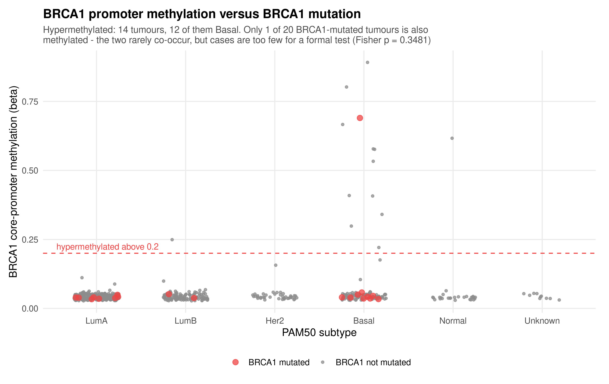

| | Not hypermethylated | Hypermethylated |
|---|---|---|
| BRCA1 not mutated | 638 | 13 |
| BRCA1 mutated | 19 | **1** |

Promoter hypermethylation appears in **14 of 671 tumours (2.1%), 12 of them basal-like** — the subtype in which
BRCA1 loss is characteristic. Only one BRCA1-mutated tumour is also hypermethylated, consistent with the two
mechanisms acting as alternatives. Fisher exact p = 0.348: the overlap is rare, but case numbers are too small
for a formal conclusion.

### 9.2 Promoter methylation differs by subtype — substantially for two genes

All ten promoters differ significantly between PAM50 subtypes, which is expected with 671 patients: large
cohorts detect very small differences. A difference was counted as **substantial** only when subtype medians
differed by at least 0.10 β.

| Gene | LumA | LumB | Her2 | Basal | Normal | q-value | Substantial |
|---|---|---|---|---|---|---|---|
| RASSF1 | 0.53 | 0.61 | 0.48 | **0.09** | 0.28 | 3×10⁻³⁷ | **yes** |
| GSTP1 | 0.15 | **0.37** | 0.31 | **0.04** | 0.08 | 6×10⁻³⁸ | **yes** |
| ESR1 | 0.10 | 0.08 | 0.11 | 0.11 | 0.16 | 6×10⁻¹⁷ | no |
| RARB | 0.10 | 0.11 | 0.16 | 0.10 | 0.10 | 9×10⁻⁶ | no |
| APC, CDH1, FOXA1, PGR, BRCA1, MLH1 | ≤ 0.14 | ≤ 0.12 | ≤ 0.15 | ≤ 0.15 | ≤ 0.14 | ≤ 0.04 | no |

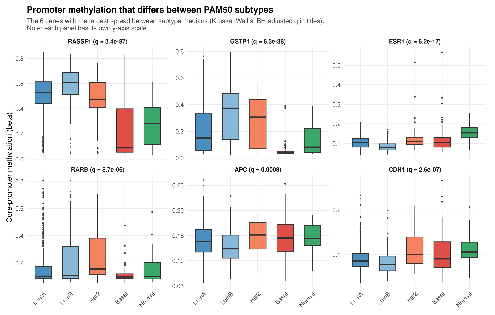

RASSF1 and GSTP1 are both sharply lower in basal-like tumours, matching the low CpG-island methylation of that
subtype seen in the global measures.

### 9.3 Methylation clusters carry mutation and survival structure

Mutation frequencies differ across the five clusters for **9 of 14 genes tested (q < 0.05)**. The sharpest
contrast is cluster MC1 — **90% TP53-mutated, 3% PIK3CA-mutated**, the classic basal-like pattern — against the
luminal clusters MC3 and MC5, which are PIK3CA-rich and TP53-poor. Clusters also differ in age, tumour mutation
burden, stage and histology (all q < 0.05).

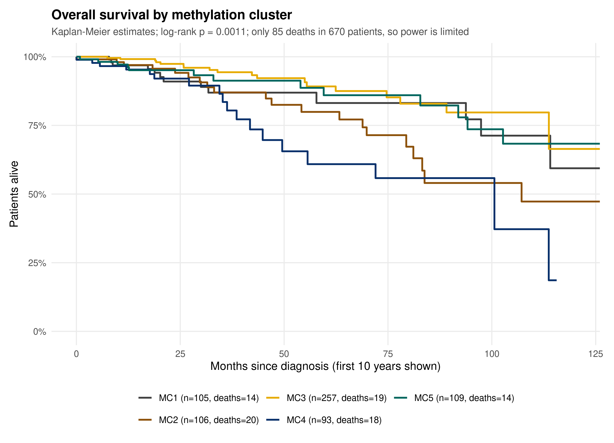

| Cluster | Patients | Deaths | 5-year survival | Hazard ratio vs MC3 (95% CI) | p |
|---|---|---|---|---|---|
| MC1 | 105 | 14 | 83.1% | 2.00 (0.96–4.18) | 0.065 |
| MC2 | 106 | 20 | 79.9% | 1.72 (0.89–3.33) | 0.108 |
| MC3 | 257 | 19 | 89.2% | reference | — |
| MC4 | 93 | 18 | **60.9%** | **3.19 (1.65–6.17)** | **0.0006** |
| MC5 | 109 | 14 | 86.0% | 1.21 (0.59–2.50) | 0.606 |

Log-rank p = 0.0011 across clusters. In the same Cox model each additional year of age raised risk by 4%
(HR 1.04) and stage III–IV nearly tripled it (HR 2.83). **Cluster MC4 retains a threefold higher risk after
adjustment for age and stage**, so methylation groups carry prognostic information that is not merely a
restatement of clinical stage. With 85 deaths and short follow-up this is an indication, not a confirmed
prognostic marker.

### 9.4 Methylation and age

CpG-island methylation rises with age at diagnosis (Spearman ρ = 0.21, q = 4.3×10⁻⁷) while open-sea methylation
falls slightly (ρ = −0.09, q = 0.029) — the established epigenetic ageing pattern, and a further check that the
processed data behaves correctly.

---

## 10. AI-ready feature table (script 07)

### 10.1 Target and cohort

The target is the same `five_year_survival` definition used in the clinical–genomics module: 1 if the patient
was alive with at least 60 months of follow-up or died after 60 months, 0 if they died within 60 months, and
excluded if alive with less than 60 months of follow-up, because that outcome cannot be known.

| Stage | Patients |
|---|---|
| Patients with methylation data | 671 |
| Censored (alive, < 60 months) — excluded | 459 |
| Missing follow-up — excluded | 1 |
| **Modelling cohort** | **211** — 152 survived, 59 died |
| Training set (70%) | 147 — 106 survived, 41 died |
| Test set (30%) | 64 — 46 survived, 18 died |

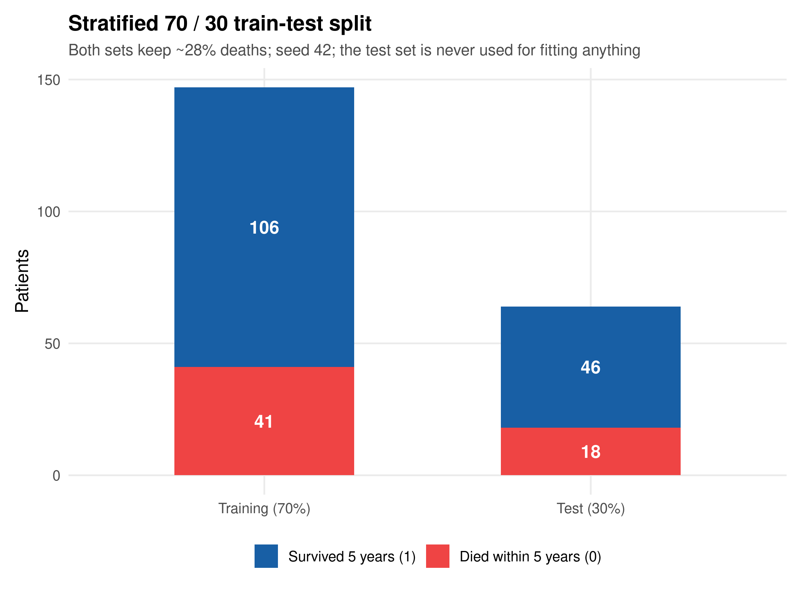

Both sets keep the same share of deaths (27.9% and 28.1%); the split is stratified with seed 42. **This cohort
size is the main statistical constraint on Section 11.**

### 10.2 Feature blocks

| Block | Content | N |
|---|---|---|
| **A — Clinical and genomic** | Inherited unchanged: age, stage, tumour mutation burden, five mutation-type counts, 20 gene flags, histology categories | 34 |
| **B — Methylation summary** | Eight global averages, core-promoter methylation of ten genes, BRCA1 hypermethylation flag | 19 |
| **C — Methylation components** | methPC1–methPC10 from the 5,000 most variable CpGs; 51.4% of training variance | 10 |

Two histology columns (metaplastic carcinoma, infiltrating carcinoma NOS) were constant across all training
patients and carried no information, taking block A from 36 to 34. The three feature sets compared in
Section 11 are **A (34), B+C (29) and A+B+C (63)**.

No feature was selected by its association with survival; the blocks were fixed in advance from the
clinical–genomic pipeline and the published methylation literature, which avoids the optimistic results that
feature selection produces on a cohort of this size.

### 10.3 Leakage-safe preprocessing

The train–test split happens first, before anything is learned from the data. Every step that learns a quantity
uses the 147 training patients only and is then applied unchanged to the 64 test patients:

- the 5,000 most variable CpGs are chosen on training patients;
- the methylation PCA is fitted on them, and test patients are projected onto the resulting rotation;
- continuous features are z-scored with the training mean and standard deviation;
- missing values (age in one patient, stage in eight) are set to 0 after scaling, which is the training mean.

Script 05's principal components and script 03's clusters were deliberately **not** used as features, because
both were computed with the test patients included. Survival columns, PAM50 subtype and technical columns were
also excluded.

---

## 11. Modelling and evaluation (script 08b)

### 11.1 Design

Five classifiers — Logistic Regression, Elastic Net (α = 0.5, λ by 5-fold cross-validation on AUC), Random
Forest (500 trees, class weights), XGBoost (depth 4, η 0.05, rounds chosen by training-set cross-validation) and
a radial-kernel SVM — each trained on all three feature sets, giving fifteen models. Threshold 0.5, seed 42.
Class weights make deaths, 28% of patients, count more during training.

Three settings differ deliberately from the earlier implementation, all of them corrections:

| Issue | Earlier behaviour | Here |
|---|---|---|
| XGBoost round selection | Early stopping on the **test** set, which was then scored — leakage that makes results optimistic | Rounds chosen by 5-fold cross-validation on the training set (32, 10 and 95 for the three sets) |
| XGBoost class weight | `scale_pos_weight = n_survived / n_died` up-weighted the **majority** class | `n_died / n_survived`; with the earlier value XGBoost stopped after two rounds and flagged no deaths |
| ROC direction | pROC's automatic direction can silently turn a worse-than-chance model into a better-than-chance one | Direction fixed (controls = 0, cases = 1) |

### 11.2 Results on the held-out test set (64 patients, 18 deaths)

| Model | A: clinical + genomic | B+C: methylation | **A+B+C: combined** | Change A → A+B+C | DeLong p |
|---|---|---|---|---|---|
| Logistic Regression | 0.624 | 0.673 | 0.621 | −0.004 | 0.97 |
| **Elastic Net** | 0.742 | 0.657 | **0.792** | **+0.050** | 0.26 |
| Random Forest | 0.679 | 0.642 | 0.665 | −0.014 | 0.88 |
| XGBoost | 0.684 | 0.642 | 0.657 | −0.027 | 0.69 |
| SVM | 0.731 | 0.510 | 0.682 | −0.048 | 0.50 |

**Best model: Elastic Net on the combined set, AUC 0.792 (95% CI 0.68–0.91).**

| A — clinical + genomic | B+C — methylation only | **A+B+C — combined** |
|---|---|---|
| 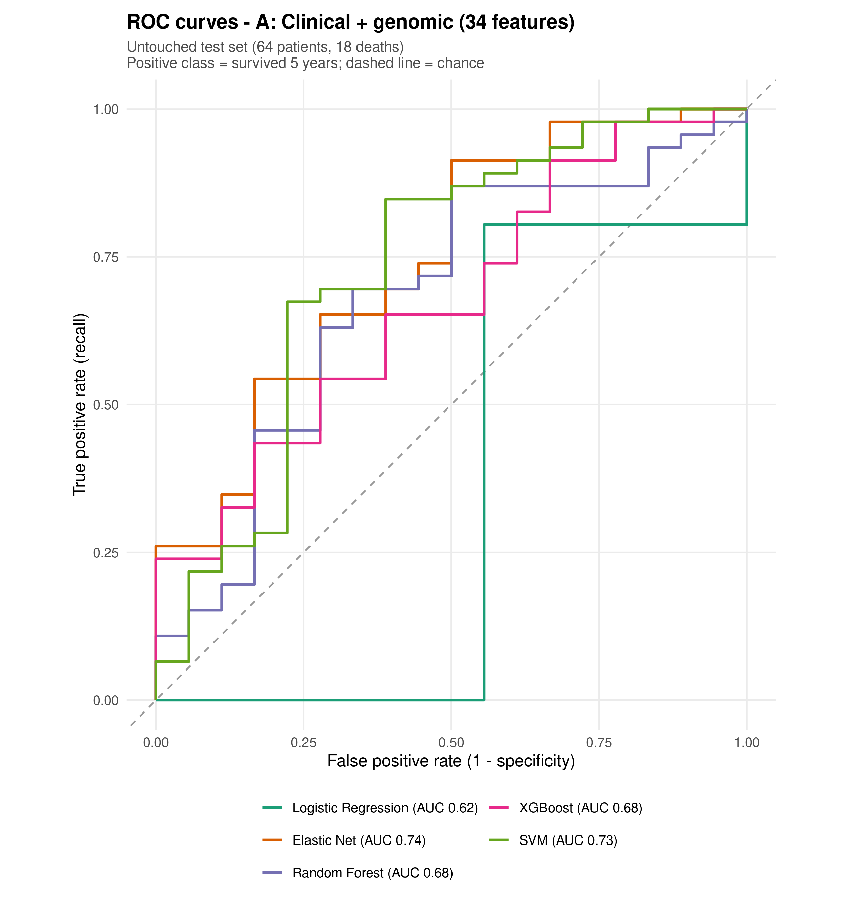 | 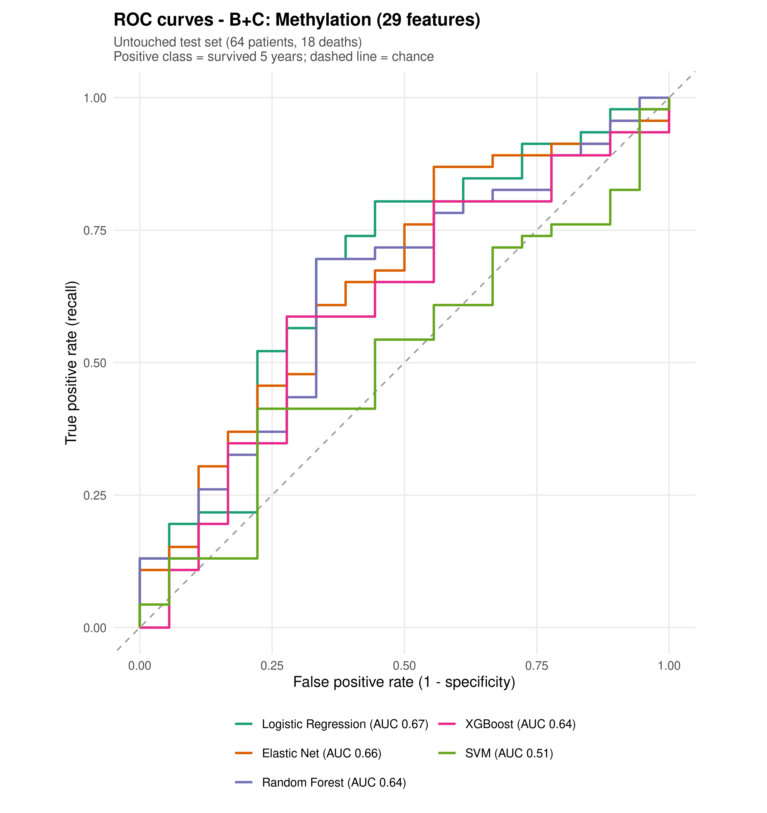 | 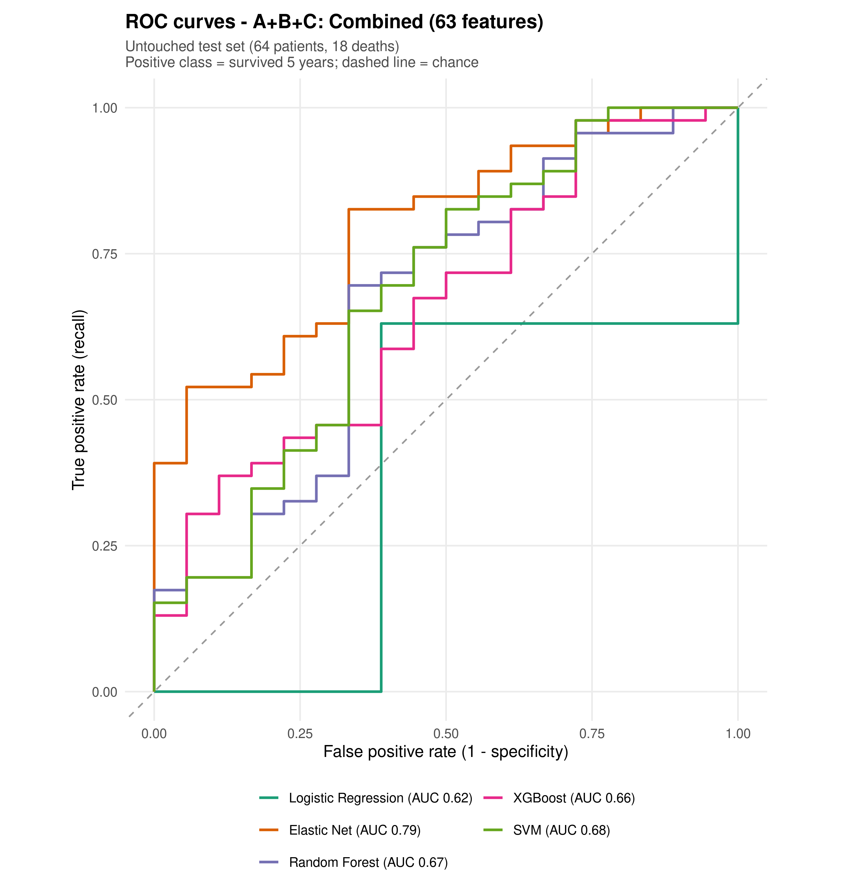 |

**Reading the curves.** The combined Elastic Net curve leaves the origin almost vertically: at a false-positive
rate of 0.06 it already identifies **52% of survivors**, where the same model without methylation reaches
**26%**, and it stays above the clinical–genomic curve across nearly the whole range. Methylation alone (middle
panel) is weak, as expected of a layer that describes tumour biology rather than clinical stage — yet the
combination produces a curve that neither feature set achieves separately. That pattern indicates
**complementary information**, not redundancy.

**Why the gain does not reach significance: events, not signal.** The test set contains 18 deaths. With so few
events a 95% confidence interval for AUC spans roughly ±0.15 and the paired DeLong test has very little power,
so a +0.050 gain returns p = 0.26 despite the visible separation of the curves.

| | |
|---|---|
| 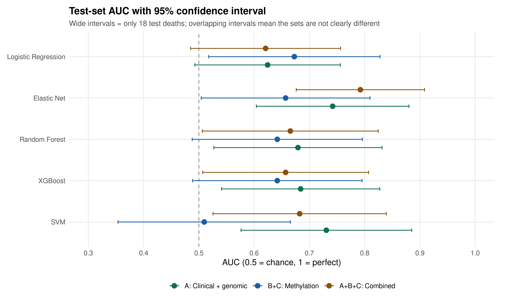 | 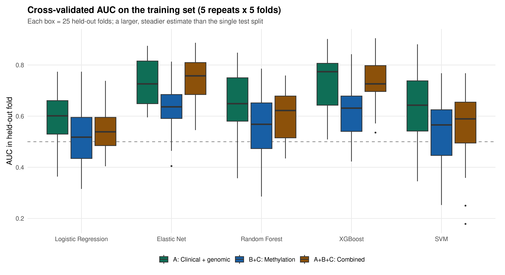 |
| Intervals ±0.15 wide — the price of 18 test deaths | 25 held-out folds per model, a far steadier estimate |

### 11.3 Repeated cross-validation

A single split with 18 deaths is unstable, so every model was refitted 25 times on four fifths of the training
patients and scored on the remaining fifth (five repeats of five-fold cross-validation).

| Model | A | B+C | A+B+C | Gain A → A+B+C | Folds improved |
|---|---|---|---|---|---|
| **Elastic Net** | 0.729 | 0.633 | **0.739** | **+0.010** | **60%** |
| XGBoost | 0.736 | 0.626 | 0.733 | −0.004 | 48% |
| Random Forest | 0.650 | 0.559 | 0.605 | −0.046 | 48% |
| SVM | 0.633 | 0.537 | 0.560 | −0.074 | 36% |
| Logistic Regression | 0.594 | 0.524 | 0.544 | −0.050 | 40% |

Cross-validation agrees with the test set: the regularised model gains from methylation and improves in most
folds, while unregularised and tree-based models lose ground when 29 extra columns are added to a training set
containing 41 deaths. Elastic Net handles that situation best because it shrinks unhelpful features to zero — it
retained 17 of the 63 features, five of them methylation components.

### 11.4 Where the models draw their information

| Model | A: clinical + genomic | B: methylation summary | C: methylation components |
|---|---|---|---|
| XGBoost (gain) | 38.9% | 8.7% | **52.4%** |
| Random Forest (accuracy decrease) | 53.3% | 12.8% | **33.9%** |
| Elastic Net (absolute coefficient) | 81.1% | 3.1% | **15.8%** |

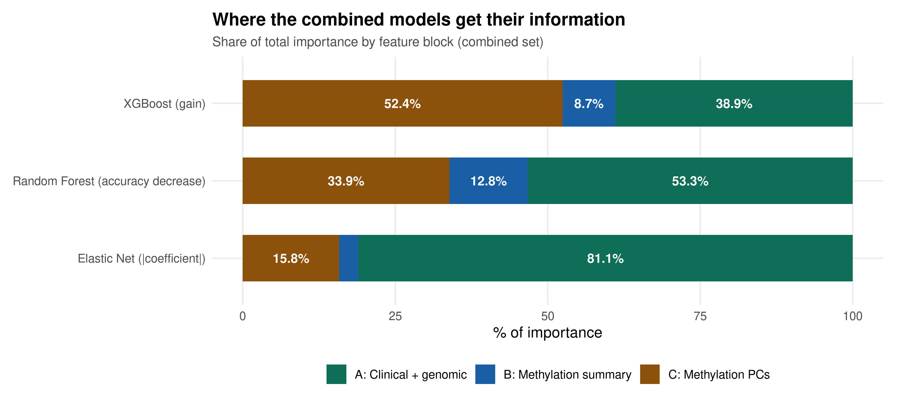

Stage is the top single feature in both tree models, followed by age and then by methylation components
methPC6, methPC3 and methPC4. **The epigenomic layer supplies over half of the information XGBoost relies on**,
even though the additional discrimination it provides cannot be proven significant at this cohort size.

### 11.5 Behaviour at the 0.5 threshold

A good ranking does not automatically give useful yes/no predictions. On the combined set the number of deaths
correctly flagged out of 18 was: Logistic Regression 11, XGBoost 10, Elastic Net 3, Random Forest 1, SVM 0.
Because 72% of test patients survived, a model predicting survival for everyone already achieves high recall,
which is why balanced accuracy and the confusion matrices matter more than accuracy here. The threshold was kept
at 0.5 for comparability with the clinical–genomics module; choosing it on training data is listed in
Section 16 as a natural next step.

---

## 12. Technologies and tools

| Layer | Tools |
|---|---|
| Language | R 4.6.1, run from the command line with `Rscript` on Ubuntu (WSL) |
| Data retrieval | TCGAbiolinks (GDC query, subtype tables), curl (per-file download with md5 verification) |
| Large-matrix handling | SummarizedExperiment, data.table, matrixStats (copy-free row and column statistics) |
| Statistics | survival (Kaplan–Meier, log-rank, Cox), base R (Wilcoxon, Kruskal–Wallis, Fisher, Spearman, BH correction) |
| Machine learning | glmnet, randomForest, xgboost, e1071, pROC (AUC, DeLong tests) |
| Visualisation | ggplot2, pheatmap |

Every script prints its progress, writes a full text report, and accepts `--tag=test` for a dry run whose
outputs carry a `_test` suffix so real results are never overwritten. Seed 42 throughout.

---

## 13. Repository structure

```
02_Epigenomics/
├── scripts/
│   ├── 01_prepare_methylation_data.R           query the GDC, match files to the cohort
│   ├── 02_download_beta_matrix.R               per-file download, md5 verified, resumable
│   ├── 02b_assemble_beta_matrix.R              memory-lean assembly + probe/sample annotation
│   ├── 03_clean_methylation_data.R             sample and probe QC, PCA, clustering
│   ├── 04_match_harmonise_ids.R                ID checks, one sample per patient
│   ├── 05_integrate_epigenomics.R              methylation features, merge, biological analyses
│   ├── 07_build_epigenomic_feature_table.R     target, split, feature blocks, scaling
│   └── 08b_train_epigenomic_baseline_models.R  five models × three feature sets
│
└── outputs/
    ├── figures/
    │   ├── 03_qc/            quality control, probe annotation, PCA, clusters
    │   ├── 04_ids/           cohort flow, replicate handling, representativeness
    │   ├── 05_integration/   BRCA1, promoters, clusters, survival, age
    │   ├── 07_features/      target, split, feature blocks, PCA scree
    │   └── 08b_models/       ROC curves, AUC intervals, cross-validation, importance
    ├── tables/               result tables mirroring the figure folders
    └── models/               the fifteen fitted models with their feature sets and settings
```

The trained models are stored in a single `.rds` holding all fifteen fitted objects together with the feature
sets, XGBoost rounds, threshold and seed, so no model is separated from the context needed to reuse it:

```r
m <- readRDS("outputs/models/08b_trained_models.rds")
names(m$models)                                    # all fifteen
en <- m$models[["Elastic Net | A+B+C: Combined"]]  # the best model
m$feature_sets[["A+B+C: Combined"]]                # the 63 feature names
```

---

## 14. Reproducing the pipeline

```bash
# R 4.6.1 · ~8 GB RAM · ~10 GB free disk
Rscript -e 'install.packages(c("data.table","matrixStats","ggplot2","pheatmap","survival",
                               "glmnet","randomForest","xgboost","e1071","pROC"))'
Rscript -e 'BiocManager::install(c("TCGAbiolinks","SummarizedExperiment"))'

cd path/to/02_Epigenomics

Rscript scripts/01_prepare_methylation_data.R            # ~1 min
Rscript scripts/02_download_beta_matrix.R                # hours (network), resumable
Rscript scripts/02b_assemble_beta_matrix.R               # ~14 min
Rscript scripts/03_clean_methylation_data.R              # ~10 min
Rscript scripts/04_match_harmonise_ids.R                 # ~4 min
Rscript scripts/05_integrate_epigenomics.R               # ~2 min
Rscript scripts/07_build_epigenomic_feature_table.R      # ~1 min
Rscript scripts/08b_train_epigenomic_baseline_models.R   # ~1 min
```

Scripts 01, 04 and 05 read the clinical–genomic dataset from a sibling project folder, and each script sets an
absolute working directory in its header — adjust both to your own layout before running.

---

## 15. Limitations

- **Event-limited cohort.** 211 patients with 59 deaths, of which only 18 are in the test set. This is the
  binding constraint on every model comparison and the reason a visible ROC improvement cannot be declared
  statistically significant.
- **Censoring removes most patients.** 459 patients with methylation profiles carry no usable five-year label.
- **The sub-cohort is not fully representative** of the parent cohort in stage, tumour mutation burden and PAM50
  subtype (Section 7).
- **Fixed 0.5 threshold**, kept for comparability, leaves several models flagging very few deaths.
- **Cross-validation is mildly optimistic** for feature sets containing principal components, since the PCA was
  fitted on all training patients before folds were drawn; held-out test results are unaffected.
- **No Infinium type I/II normalisation** beyond the GDC pipeline, and no correction for tumour purity — some
  flagged samples are probably low-purity.
- **Survival analysis by cluster** rests on 85 deaths with short follow-up, and clusters were defined using all
  patients.
- **No external validation cohort.** Generalisability was assessed with a held-out 30% test set and repeated
  cross-validation rather than an independent dataset.

---

## 16. Future directions

1. **Add events rather than features.** Pooling cohorts or extending follow-up to roughly 60 test deaths would
   make the observed Elastic Net gain testable rather than indicative.
2. **Model time to event.** A Cox model uses all 671 patients including censored follow-up, recovering the
   statistical power lost to a binary five-year target.
3. **Select CpGs for prognosis inside training folds only** (nested cross-validation), or adopt published
   prognostic methylation signatures, instead of relying on unsupervised components.
4. **Reduce redundancy** among the eight global averages, which are highly correlated with one another
   (11 feature pairs with |r| ≥ 0.9).
5. **Add biologically motivated features** such as tumour purity and epigenetic age estimated from the same
   array.
6. **Choose the decision threshold on training data** so that clinically important deaths are actually flagged.
7. **Extend reproducibility** with Conda or Docker environment definitions and a Nextflow wrapper around the
   existing scripts.

---

## 17. Contribution

Pipeline design, implementation, analysis and documentation by **Muteeba Azhar**, as the Month 2 deliverable of
the Bioinformatics and AI-Ready Multi-Omics Internship at MultiOmics Intelligence: GDC dataset evaluation, the
resumable md5-verified download strategy, the memory-lean matrix assembler and its validation against
`GDCprepare()`, methylation quality control and probe filtering, identifier harmonisation, promoter and global
feature engineering, integration with the clinical–genomic layer, the leakage-safe feature table, model training
and comparison, and all figures, tables and written documentation in this repository.

---

## 18. Acknowledgements and data attribution

- Methylation data generated by **The Cancer Genome Atlas (TCGA) Research Network**
  (https://www.cancer.gov/tcga) and obtained from the **NCI Genomic Data Commons**. Probe annotation from the
  **Zhou lab InfiniumAnnotation** project. Published methylation-cluster and PAM50 labels via **TCGAbiolinks**.
- Analysis carried out during the Bioinformatics and AI-Ready Multi-Omics Internship at **MultiOmics
  Intelligence**.
- Software: the R Core Team and the authors of TCGAbiolinks, SummarizedExperiment, data.table, matrixStats,
  ggplot2, pheatmap, survival, glmnet, randomForest, xgboost, e1071 and pROC.

This repository contains analysis code and derived results from open-access, de-identified public datasets. No
restricted or patient-identifiable data is included, and no individual-level raw data is redistributed.

### References

- Zhou W, Laird PW, Shen H. *Comprehensive characterization, annotation and innovative use of Infinium DNA
  methylation BeadChip probes.* Nucleic Acids Research, 2017.
- Berger AC *et al.* *A comprehensive pan-cancer molecular study of gynecologic and breast cancers.* Cancer
  Cell, 2018.
- The Cancer Genome Atlas Network. *Comprehensive molecular portraits of human breast tumours.* Nature, 2012.
- Colaprico A *et al.* *TCGAbiolinks: an R/Bioconductor package for integrative analysis of TCGA data.* Nucleic
  Acids Research, 2016.
- DeLong ER, DeLong DM, Clarke-Pearson DL. *Comparing the areas under two or more correlated receiver operating
  characteristic curves: a nonparametric approach.* Biometrics, 1988.

---

*R · TCGA-BRCA · Illumina 450K · GDC · leakage-safe preprocessing · five models across three feature sets*
