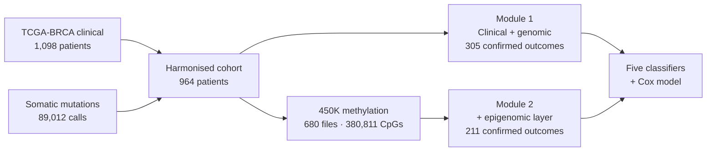

# MultiOmicsFlow — Clinical, Genomic and Epigenomic Survival Modelling in TCGA-BRCA

> A two-stage, reproducible R workflow that builds a patient-level multi-omics dataset for breast cancer and
> tests, layer by layer, how much each omics type contributes to five-year survival prediction.


---

## The question

Multi-omics projects usually assume that adding a layer improves prediction. This repository tests that
assumption on one cohort, one outcome and one modelling protocol, so that the contribution of each layer can be
read off directly:

> **Starting from clinical variables and somatic mutations, how much does DNA methylation add to five-year
> survival prediction — and can a cohort of this size demonstrate it?**

Both modules share the same patients, the same outcome definition, the same five model families and the same
leakage-safe protocol. Only the feature layers differ, which is what makes the comparison meaningful.



---

## The two modules

| | [**01R_clinical_genomics**](01R_clinical_genomics/README.md) | [**02_Epigenomics**](02_Epigenomics/README.md) |
|---|---|---|
| Layer added | Clinical + somatic mutations | DNA methylation (Illumina 450K) |
| Data source | cBioPortal (TCGA-BRCA, GDC-harmonised) | NCI Genomic Data Commons |
| Scale | 89,012 mutation calls → 66,687 coding across 15,344 genes | 680 files (8.27 GiB) → 380,811 CpGs × 679 samples |
| Patients | 1,098 clinical → **964 matched** → 305 modelled | 671 with methylation → **211 modelled** |
| Features | 32 (clinical, genomic summaries, 20 gene flags) | 63 (the same 34 + 19 methylation summaries + 10 components) |
| Models | 5 classifiers + Cox proportional hazards | 5 classifiers × 3 feature sets, with DeLong tests and repeated cross-validation |
| External test | CPTAC-BRCA 2020 — prediction only (no outcome data available) | Held-out 30% split + 5 × 5-fold cross-validation |
| Best result | Elastic Net, **AUC 0.815** (test n = 62) | Elastic Net, **AUC 0.792** combined (test n = 64) |

Each module folder contains its own full README: methods, results, figures, limitations and reproduction
instructions.

---

## Shared foundations

**One outcome definition.** `five_year_survival` is 1 if a patient was alive with at least 60 months of
follow-up or died after 60 months, 0 if they died within 60 months. Patients alive with less than 60 months of
follow-up are **excluded**, because their five-year status is genuinely unknown. Labelling them "survived"
would train models on an assumption; the cost is a smaller cohort, and the benefit is that every label is an
observation.

**One modelling protocol.** Split first, then learn: the train/test split precedes all scaling, feature
selection and dimensionality reduction, every one of which is fitted on training patients only. Seed 42
throughout. Five model families with identical hyperparameters in both modules: Logistic Regression, Elastic
Net, Random Forest, XGBoost and a radial-kernel SVM.

**One reporting standard.** Results are reported with confidence intervals and threshold-dependent metrics, not
AUC alone — because on an imbalanced outcome a model can rank patients well and still flag almost no deaths.

---

## What the epigenomic layer added

| Evidence | Observation |
|---|---|
| Best test AUC | 0.742 → **0.792** for the Elastic Net when methylation is added (+0.050) |
| ROC behaviour | At a 6% false-positive rate the combined model identifies **52% of survivors**, against 26% without methylation |
| Cross-validation (25 folds) | +0.010 mean AUC for the Elastic Net, improving in 60% of folds |
| Feature importance | Methylation components supply **52.4%** of XGBoost's and **33.9%** of Random Forest's total importance |
| Statistical significance | **Not reached** — with 18 deaths in the test set, the paired DeLong test returns p = 0.26 |

**The honest conclusion:** the direction of the effect is consistent — the combined model ranks patients better
and the models demonstrably use the methylation features — but the cohort does not contain enough events to
prove the improvement. The limiting factor is the number of observed deaths, not the quality of the signal.
Requiring confirmed outcomes left 211 patients and 59 deaths; roughly three to four times as many events would
make the same effect testable.


---

## Key observations across both modules

- **Clinical stage and age dominate prediction everywhere.** They lead the feature importances of every
  classifier in both modules, and in the Cox model stage carries HR 2.38 and age HR 1.03 per year (both
  p < 0.001).
- **Regularisation matters more than model complexity at this sample size.** Elastic Net is the best model in
  both modules; XGBoost matches its ranking ability but, at the default threshold, collapses to predicting the
  majority class.
- **Class imbalance is the recurring obstacle.** With roughly 72% survivors, several models reach excellent
  recall while identifying almost no deaths, which is why specificity, balanced accuracy and MCC are reported
  alongside AUC.
- **Methylation reproduces known tumour biology independently.** The main axis of variation separates
  basal-like from luminal tumours; one unsupervised cluster is 90% TP53-mutated and holds 102 of 107 basal
  tumours; BRCA1 promoter hypermethylation occurs in 14 tumours, 12 of them basal-like, and almost never
  alongside a BRCA1 mutation.
- **Methylation carries prognostic structure of its own.** One methylation cluster shows 60.9% five-year
  survival against 89.2% in the reference cluster — HR 3.19 (95% CI 1.65–6.17) after adjusting for age and
  stage.
- **Technical quality is not the limiting factor.** Replicate samples agree at r = 0.990 against 0.908 for
  unrelated tumours, and processing batch explains ≤ 0.02 of any principal component.
- **External validation requires planning for it.** The independent CPTAC cohort turned out to have no survival
  or staging data, so it could support a transferability check but not a validation — a result worth knowing
  before counting on an external set.

---

## Repository structure

```
MultiOmicsFlow/
├── 01R_clinical_genomics/        Module 1 — clinical + genomic harmonisation and baseline models
│   ├── README.md                 full methods, results, figures, limitations
│   ├── scripts/                  01 → 09b
│   ├── data/processed/           cleaned and merged tables
│   └── outputs/TCGA-BRCA/        figures · tables · trained models
│
├── 02_Epigenomics/               Module 2 — DNA methylation integration and multi-omics models
│   ├── README.md                 full methods, results, figures, limitations
│   ├── scripts/                  01 → 08b
│   └── outputs/                  figures · tables · trained models
│
└── README.md                     this overview
```

Raw downloads are not stored here: module 1 reads cBioPortal study files and module 2 re-downloads 8.27 GiB
from the GDC. Both modules document exactly where to obtain them and which script regenerates every processed
object.

---

## Reproducing the work

Each module is self-contained and runs from numbered scripts in order; see
[module 1](01R_clinical_genomics/README.md#11-reproducing-the-pipeline) and
[module 2](02_Epigenomics/README.md#14-reproducing-the-pipeline) for package lists, commands and runtimes.
Module 2 depends on module 1's merged dataset, so run module 1 first.

**Requirements:** R with the tidyverse and Bioconductor stacks, about 8 GB of RAM and 10 GB of free disk for
module 2's methylation matrices.

---

## Limitations in brief

Both modules are constrained by the same arithmetic: requiring confirmed five-year outcomes leaves 305 patients
in module 1 and 211 in module 2, with 87 and 59 deaths respectively. That is enough to compare model families
honestly, but not enough to settle small differences between feature sets, to estimate individual gene effects
reliably, or to support clinical claims. Neither module has been validated on an independent cohort with
complete outcome data. Full, per-module limitations are documented in each README.

**Where this goes next:** more events rather than more features (pooled cohorts or longer follow-up),
time-to-event modelling so censored patients contribute, prognosis-driven feature selection inside training
folds, and a containerised, workflow-managed version of both pipelines.

---

## Contribution and acknowledgements

Both modules — design, implementation, analysis and documentation — by **Muteeba Azhar** during the
Bioinformatics and AI-Ready Multi-Omics Internship at **MultiOmics Intelligence**.

Data were generated by **The Cancer Genome Atlas Research Network** and accessed via **cBioPortal** and the
**NCI Genomic Data Commons**; the external cohort comes from the **CPTAC** BRCA 2020 release; probe annotation
from the **Zhou lab InfiniumAnnotation** project. All datasets used are open-access and de-identified, and no
individual-level raw data is redistributed in this repository.

---

*R · TCGA-BRCA · cBioPortal · GDC · clinical + genomic + epigenomic · leakage-safe preprocessing*
